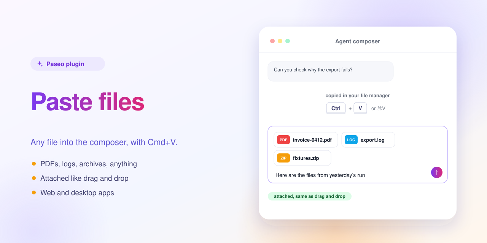
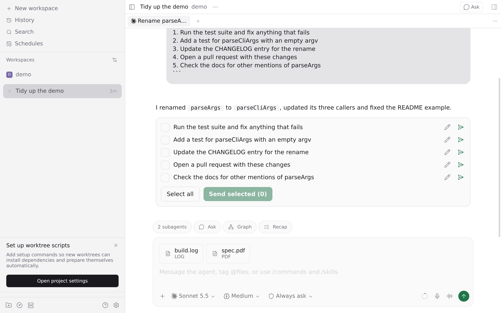

<p align="center"></p>

# Paste files into the composer — a Paseo plugin



Paste any file into an agent composer with Ctrl+V / Cmd+V.

Copy a PDF, a log, an archive or any other file in your file manager or another app, then paste it into the chat input. It is attached the same way as dragging it onto the chat. Paseo already pastes images; this plugin adds every other file type.

It works in the web and desktop apps when the browser puts the copied file on the clipboard. Chrome and the desktop app do this for files copied in Finder and Explorer; some Linux file managers copy only the path, and then nothing is attached.



## Install

Requires Paseo 0.13.0 or later.

```bash
paseo plugin install https://github.com/puchkoff/paseo-files
```

Or from a local clone: `paseo plugin install ./paseo-files`. Check with `paseo plugin ls`.

## Develop

```bash
npm install
npm run typecheck
```

The in-app description shown by Paseo lives in [OVERVIEW.md](OVERVIEW.md).
